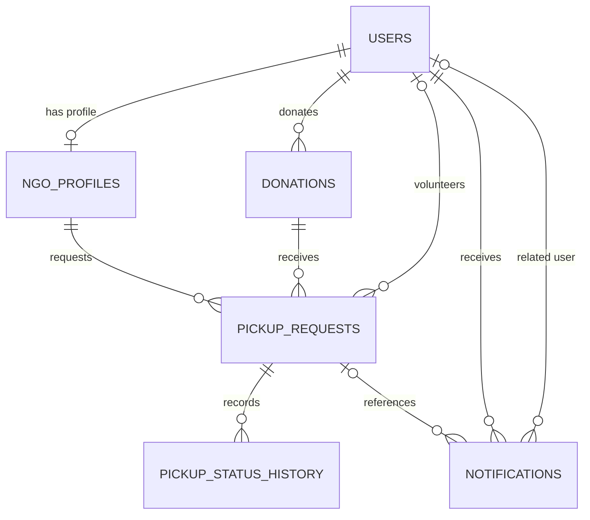

# FoodBridge PostgreSQL Database Design

> **Coordination status:** Member 2 (backend) approved this design unchanged. In particular, see the compatibility notes before applying the SQL or treating these names as a drop-in replacement for the current backend contract.

## ER diagram



`PICKUP_REQUESTS.ngo_id` stores the NGO user's `users.id`; it references the unique `ngo_profiles.user_id`. Volunteer and donor IDs likewise refer to `users.id`. A volunteer profile table is not needed because the current application has no volunteer-only attributes beyond the user's role.

## Relationships and normalization

- A user may have zero or one NGO profile. NGO-specific organization and verification data lives in `ngo_profiles`, rather than being repeated on `users`.
- A donor user may create many donations. Each donation has one donor.
- An NGO may create many pickup requests; each request is for one donation. A donation can have multiple pending requests, but only one request can be accepted or in progress at a time.
- A pickup request can have zero or one assigned volunteer. The service must verify the referenced user has the `VOLUNTEER` role.
- Pickup status changes are stored as separate history rows. The service should insert the status update and its history row in the same transaction.
- Notifications belong to one user. Optional typed foreign keys provide referential integrity for a related pickup request or user instead of a polymorphic ID with no enforceable FK.
- `pickup_requests` deliberately does not repeat `donor_id`: that value is determined by its donation. Queries needing the donor should join `donations`.

The tables are in third normal form for the modeled data: NGO profile attributes are separated from user identity, and pickup requests do not duplicate donation ownership. `quantity_unit` is stored as a value because the application accepts units directly; if a controlled unit catalog becomes a requirement, it can be normalized into a referenced lookup table.

## PostgreSQL schema

```sql
CREATE TABLE users (
    id              BIGINT GENERATED BY DEFAULT AS IDENTITY PRIMARY KEY,
    name            VARCHAR(120) NOT NULL CHECK (btrim(name) <> ''),
    email           VARCHAR(320) NOT NULL,
    password_hash   TEXT NOT NULL CHECK (password_hash <> ''),
    phone           VARCHAR(32),
    role            VARCHAR(16) NOT NULL
                    CHECK (role IN ('DONOR', 'NGO', 'VOLUNTEER', 'ADMIN')),
    created_at      TIMESTAMPTZ NOT NULL DEFAULT now(),
    updated_at      TIMESTAMPTZ NOT NULL DEFAULT now()
);

CREATE UNIQUE INDEX users_email_lower_unique
    ON users (lower(email));

CREATE TABLE ngo_profiles (
    id                  BIGINT GENERATED BY DEFAULT AS IDENTITY PRIMARY KEY,
    user_id             BIGINT NOT NULL UNIQUE
                        REFERENCES users(id) ON DELETE CASCADE,
    organization_name   VARCHAR(200) NOT NULL
                        CHECK (btrim(organization_name) <> ''),
    registration_number VARCHAR(100) UNIQUE,
    verification_status VARCHAR(16) NOT NULL DEFAULT 'PENDING'
                        CHECK (verification_status IN ('PENDING', 'VERIFIED', 'REJECTED')),
    created_at          TIMESTAMPTZ NOT NULL DEFAULT now(),
    updated_at          TIMESTAMPTZ NOT NULL DEFAULT now()
);

CREATE TABLE donations (
    id               BIGINT GENERATED BY DEFAULT AS IDENTITY PRIMARY KEY,
    donor_id         BIGINT NOT NULL
                     REFERENCES users(id) ON DELETE RESTRICT,
    food_name        VARCHAR(200) NOT NULL CHECK (btrim(food_name) <> ''),
    food_type        VARCHAR(80) NOT NULL CHECK (btrim(food_type) <> ''),
    quantity         NUMERIC(12, 3) NOT NULL CHECK (quantity > 0),
    quantity_unit    VARCHAR(24) NOT NULL CHECK (btrim(quantity_unit) <> ''),
    preparation_time TIMESTAMPTZ NOT NULL,
    expiry_time      TIMESTAMPTZ NOT NULL,
    description      TEXT,
    pickup_location  TEXT NOT NULL CHECK (btrim(pickup_location) <> ''),
    image_url        TEXT,
    status           VARCHAR(16) NOT NULL DEFAULT 'AVAILABLE'
                     CHECK (status IN ('AVAILABLE', 'CLAIMED', 'COMPLETED', 'CANCELLED', 'EXPIRED')),
    created_at       TIMESTAMPTZ NOT NULL DEFAULT now(),
    updated_at       TIMESTAMPTZ NOT NULL DEFAULT now(),
    CONSTRAINT donations_expiry_after_preparation
        CHECK (expiry_time > preparation_time)
);

CREATE TABLE pickup_requests (
    id           BIGINT GENERATED BY DEFAULT AS IDENTITY PRIMARY KEY,
    donation_id  BIGINT NOT NULL
                 REFERENCES donations(id) ON DELETE RESTRICT,
    ngo_id       BIGINT NOT NULL
                 REFERENCES ngo_profiles(user_id) ON DELETE RESTRICT,
    volunteer_id BIGINT
                 REFERENCES users(id) ON DELETE SET NULL,
    status       VARCHAR(16) NOT NULL DEFAULT 'PENDING'
                 CHECK (status IN (
                     'PENDING', 'APPROVED', 'REJECTED', 'ASSIGNED', 'ACCEPTED',
                     'IN_TRANSIT', 'COLLECTED', 'DELIVERED', 'COMPLETED', 'CANCELLED'
                 )),
    notes        TEXT,
    requested_at TIMESTAMPTZ NOT NULL DEFAULT now(),
    updated_at   TIMESTAMPTZ NOT NULL DEFAULT now()
);

CREATE TABLE pickup_status_history (
    id                  BIGINT GENERATED BY DEFAULT AS IDENTITY PRIMARY KEY,
    pickup_request_id   BIGINT NOT NULL
                        REFERENCES pickup_requests(id) ON DELETE CASCADE,
    previous_status     VARCHAR(16),
    status              VARCHAR(16) NOT NULL
                        CHECK (status IN (
                            'PENDING', 'APPROVED', 'REJECTED', 'ASSIGNED', 'ACCEPTED',
                            'IN_TRANSIT', 'COLLECTED', 'DELIVERED', 'COMPLETED', 'CANCELLED'
                        )),
    changed_by_user_id  BIGINT
                        REFERENCES users(id) ON DELETE SET NULL,
    changed_at          TIMESTAMPTZ NOT NULL DEFAULT now(),
    note                TEXT,
    CONSTRAINT pickup_history_previous_status_valid
        CHECK (previous_status IS NULL OR previous_status IN (
            'PENDING', 'APPROVED', 'REJECTED', 'ASSIGNED', 'ACCEPTED',
            'IN_TRANSIT', 'COLLECTED', 'DELIVERED', 'COMPLETED', 'CANCELLED'
        )),
    CONSTRAINT pickup_history_status_changed
        CHECK (previous_status IS NULL OR previous_status <> status)
);

CREATE TABLE notifications (
    id                  BIGINT GENERATED BY DEFAULT AS IDENTITY PRIMARY KEY,
    user_id             BIGINT NOT NULL
                        REFERENCES users(id) ON DELETE CASCADE,
    type                VARCHAR(40) NOT NULL,
    message             TEXT NOT NULL CHECK (btrim(message) <> ''),
    pickup_request_id   BIGINT
                        REFERENCES pickup_requests(id) ON DELETE SET NULL,
    related_user_id     BIGINT
                        REFERENCES users(id) ON DELETE SET NULL,
    is_read             BOOLEAN NOT NULL DEFAULT FALSE,
    created_at          TIMESTAMPTZ NOT NULL DEFAULT now(),
    CONSTRAINT notifications_one_related_entity
        CHECK (pickup_request_id IS NULL OR related_user_id IS NULL)
);

CREATE FUNCTION set_updated_at()
RETURNS TRIGGER
LANGUAGE plpgsql
AS $$
BEGIN
    NEW.updated_at = now();
    RETURN NEW;
END;
$$;

CREATE TRIGGER users_set_updated_at
    BEFORE UPDATE ON users
    FOR EACH ROW EXECUTE FUNCTION set_updated_at();

CREATE TRIGGER ngo_profiles_set_updated_at
    BEFORE UPDATE ON ngo_profiles
    FOR EACH ROW EXECUTE FUNCTION set_updated_at();

CREATE TRIGGER donations_set_updated_at
    BEFORE UPDATE ON donations
    FOR EACH ROW EXECUTE FUNCTION set_updated_at();

CREATE TRIGGER pickup_requests_set_updated_at
    BEFORE UPDATE ON pickup_requests
    FOR EACH ROW EXECUTE FUNCTION set_updated_at();

CREATE INDEX donations_donor_created_idx
    ON donations (donor_id, created_at DESC);

CREATE INDEX donations_available_expiry_idx
    ON donations (expiry_time, created_at DESC)
    WHERE status = 'AVAILABLE';

CREATE INDEX pickup_requests_ngo_requested_idx
    ON pickup_requests (ngo_id, requested_at DESC);

CREATE INDEX pickup_requests_volunteer_updated_idx
    ON pickup_requests (volunteer_id, updated_at DESC)
    WHERE volunteer_id IS NOT NULL;

CREATE INDEX pickup_requests_donation_requested_idx
    ON pickup_requests (donation_id, requested_at DESC);

CREATE UNIQUE INDEX pickup_requests_one_pending_per_ngo_idx
    ON pickup_requests (donation_id, ngo_id)
    WHERE status = 'PENDING';

-- APPROVED reserves the donation; subsequent active states keep that reservation.
CREATE UNIQUE INDEX pickup_requests_one_active_per_donation_idx
    ON pickup_requests (donation_id)
    WHERE status IN ('APPROVED', 'ASSIGNED', 'ACCEPTED', 'IN_TRANSIT', 'COLLECTED');

CREATE INDEX pickup_history_request_changed_idx
    ON pickup_status_history (pickup_request_id, changed_at DESC);

CREATE INDEX notifications_user_created_idx
    ON notifications (user_id, created_at DESC);
```

The partial unique index is the database-level guard against two simultaneously accepted/in-progress pickup requests for one donation. It remains effective under concurrent transactions and is not a substitute for handling a unique-violation response in the backend.

Current service code must validate that `donor_id`, `ngo_id`, and `volunteer_id` have their expected roles. A future role-aware design could enforce those subtypes through composite foreign keys.

## Index recommendations

- The case-insensitive unique email index enforces the same email identity regardless of letter case and supports login lookups using `lower(email)`.
- `donations_donor_created_idx` supports donor dashboard history; the partial expiry index supports available-donation browsing and expiry ordering.
- The pickup request indexes support NGO and volunteer dashboards and donation lookups. The two partial unique indexes enforce one pending request per NGO/donation and at most one accepted or active request per donation.
- The history and notification indexes support per-request timelines and newest-first per-user notification lists.
- Foreign keys already backed by unique/primary-key indexes do not need duplicate indexes. Add more only after checking actual query plans and production query patterns.

## Cascading and deletion policy

- Deleting a user cascades to their NGO profile and notifications.
- Donations cannot be hard-deleted while pickup requests refer to them (`RESTRICT`); prefer a status change for operational records.
- NGO profiles cannot be deleted while referenced by pickup requests (`RESTRICT`).
- Deleting a volunteer user clears the optional assignment. Deleting a user referenced by a status-history row clears the actor reference but preserves the history.
- Deleting a pickup request cascades its status history and clears optional notification references.

## Backend compatibility and integration notes

This is the approved normalized target schema, not a drop-in replacement for every current query. Plan the required backend adjustments before applying it in an application environment:

- Current auth/admin queries read and write `organization_name`, `registration_number`, and `verification_status` on `users`; this design moves them to `ngo_profiles`.
- Current pickup queries expect `pickup_requests.donor_id` and `created_at`. This design omits the derivable donor ID and names the creation time `requested_at`; donor-specific listing should join through `donations`.
- Current notification queries use `related_type` and `related_id`. This design replaces the unenforced polymorphic pair with `pickup_request_id` and `related_user_id`.
- The existing pickup/volunteer services use overlapping but inconsistent terminal/in-progress statuses (`IN_TRANSIT`, `COLLECTED`, `DELIVERED`, `COMPLETED`). The allowed values above accommodate those currently observed values, but Member 2 should settle the lifecycle before implementation.
- Role-specific foreign key enforcement is not available from a plain FK to `users.id`; the service must validate roles unless role-aware composite FKs are adopted.
